<!-- Generated by scripts/render_readme.py. Edit profile.json, then render the card. -->

<h3><code>mucsandy@github ~ $ ./contributions.sh</code></h3>

  

  

<h3><code>mucsandy@github ~ $ whoami</code></h3>

<table align="center">
  <tr>
    <td valign="top" align="center">
      
    </td>
    <td valign="top" align="center">
      
    </td>
  </tr>
</table>

 

  
    Built with Python · Self-contained SVGs · Daily contribution refresh
     
    <a href="./scripts/">Source</a> ·
    <a href="./.github/workflows/refresh-heatmap.yml">Workflow</a> ·
    <a href="./SETUP.md">Setup</a>
  

